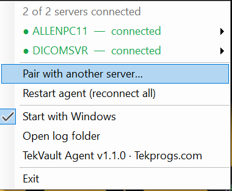
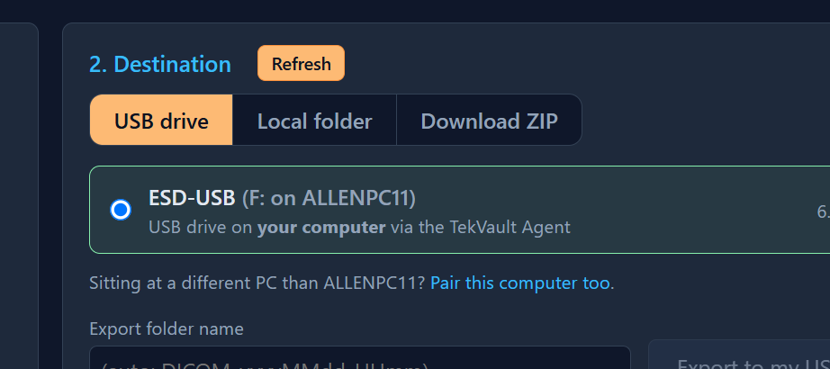
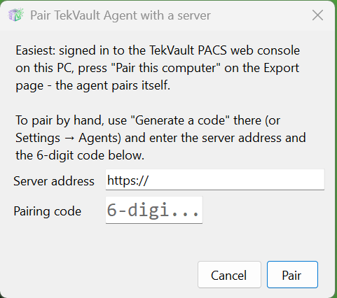
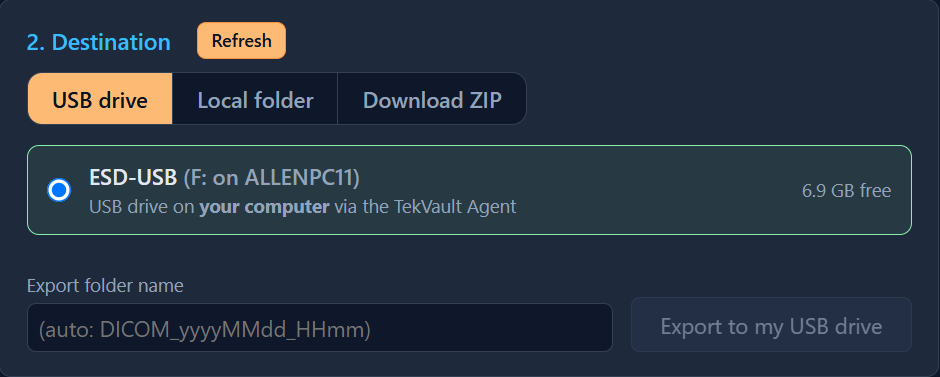
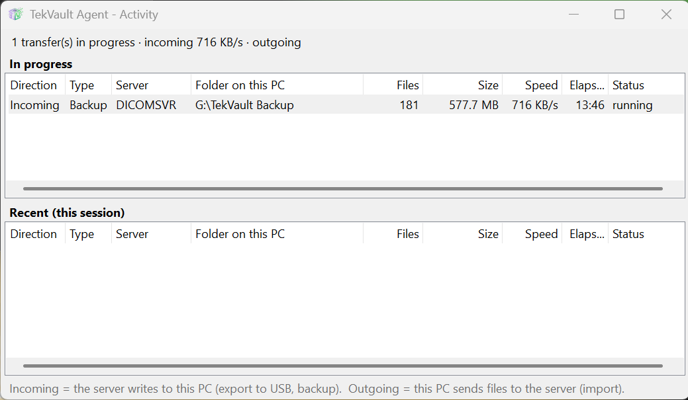
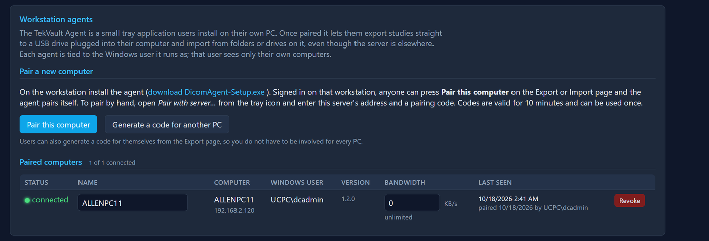

# Installing and pairing the TekVault Agent

Let users export to and import from USB drives on their own PC.

### 1. Download and install

1.  On the Import or Export page click the TekVault Agent link and run DicomAgent-Setup.exe.
2.  It installs per user (no administrator rights) and starts in the system tray.

In the console: `/agent/installer`

### 2. Pair with one click

1.  Signed in on the same PC, open the Export page and press 'Pair this computer'.
2.  The browser asks once whether to open TekVault Agent (tick 'always allow').
3.  The agent then pairs itself and shows a 'Paired' notification.
4.  A 6-digit code is shown as well in case you need the manual route below.

In the console: `/export`

### 3. Or pair by hand

1.  Right-click the tray icon, then Pair with server.
2.  Enter the server address (https://server:443) and the code from the Export page or from Settings, Agents.
3.  The icon's dot turns green when connected.
4.  One agent can be paired with several servers.

### 4. Use it

1.  Your PC's USB drives now appear as export destinations, and the Import page offers 'Folder or drive on my computer'.
2.  Windows notifications report each import/export; Restart and status are in the tray menu.
3.  Administrators see and revoke agents on the Agents page under Settings.

### 5. Watch what the agent is doing

Double-click the tray icon (or choose Show activity… from its menu) to open the Activity window: transfers in progress with direction (Incoming = the server writes to this PC, Outgoing = this PC sends to the server), folder, files, size, speed and elapsed time, plus a list of recent transfers from this session.

### 6. Manage agents (administrators)

1.  Under Settings, the Agents page lists every paired computer with its status, Windows user, agent version and last-seen time.
2.  Rename a computer inline, generate a pairing code on a user's behalf, or press Revoke to disconnect an agent that should no longer have access.

In the console: `/settings/agents`

Under Settings, go to Agents: paired computers

[Importing files without the network](import.md) · [All guides](index.md) · [Receiving images from a modality or PACS](receiving.md)
