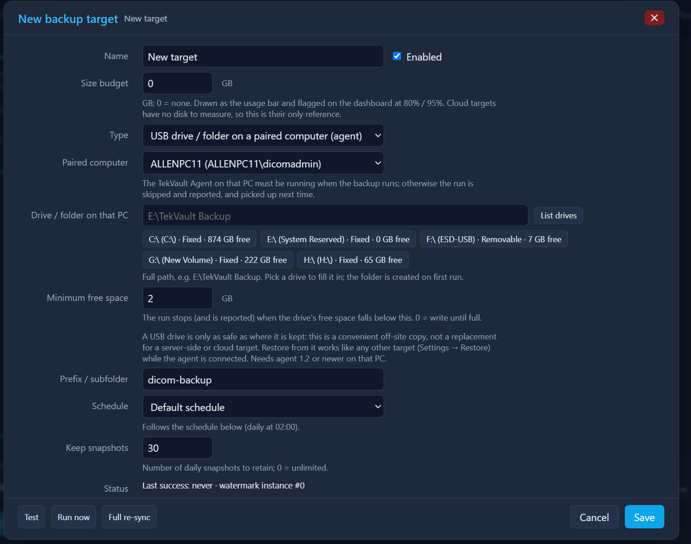
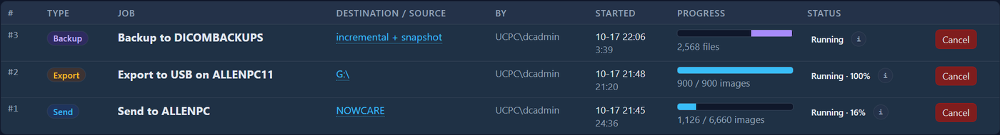
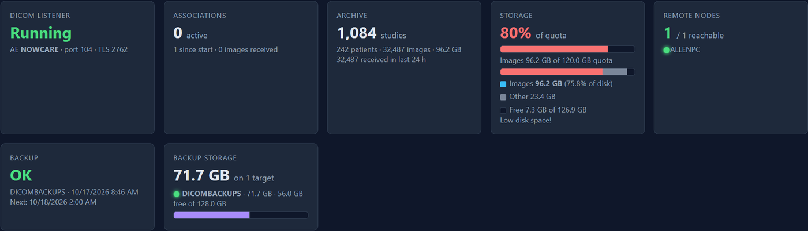
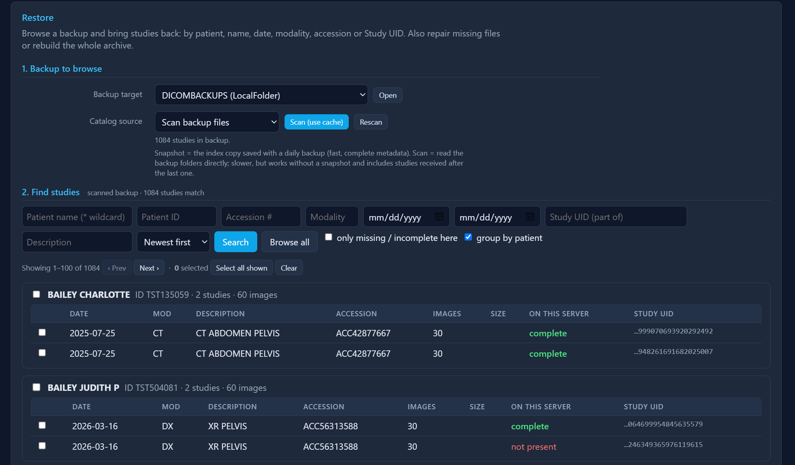
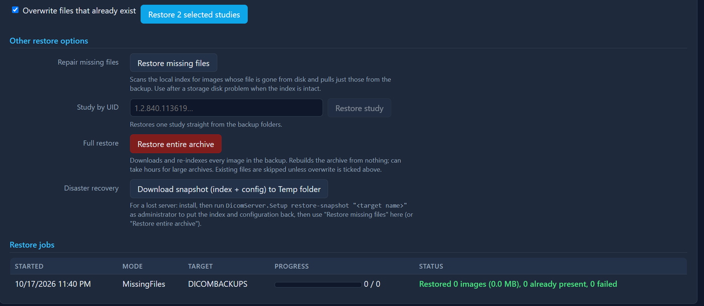

# Backups and restore

Set up a backup target, watch it run, and bring studies back when needed.

### 1. Add a backup target

1.  Under Settings, go to Backups. Add target opens the target editor.
2.  Give it a name and choose the type: a local folder / UNC share, an S3-compatible bucket, Azure Blob storage, or a USB drive / folder on a paired computer (written through the TekVault Agent; press List drives and click one).
3.  Set a size budget or minimum free space, press Test, then Save.
4.  Each target can follow the default schedule or have its own.

In the console: `/settings/backup`

### 2. Run the first backup

1.  Press Run now.
2.  Every image is copied incrementally (only new files on later runs) and a snapshot of the index database and configuration is stored with each run.
3.  Progress appears under Jobs with a purple bar.

In the console: `/jobs`

### 3. Check usage

1.  The Dashboard's Backup storage card and the Backups page under Settings show how much each target holds.
2.  A quota turns the bar orange/red as it fills.

In the console: `/`

### 4. Restore studies

1.  Under Settings, go to Restore: pick the target, search the backup catalogue by patient, date, modality, accession or Study UID, tick the studies and press Restore.
2.  'Restore missing files' repairs an archive with deleted files; 'Restore everything' rebuilds a new server from the backup.

In the console: `/settings/restore`

### 5. Repair or rebuild

1.  Below the catalogue: tick the studies and press Restore selected (Overwrite re-copies files that already exist).
2.  Under Other restore options, 'Restore missing files' pulls only images whose file is gone from disk, 'Restore study' takes a Study UID, and 'Restore entire archive' rebuilds everything from the backup.
3.  Every run appears under Restore jobs with its progress and result.

In the console: `/settings/restore`

[Storage locations and quotas](storage.md) · [All guides](index.md) · [Working with jobs](jobs.md)
