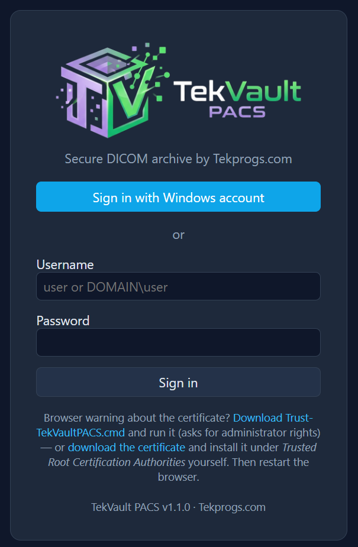
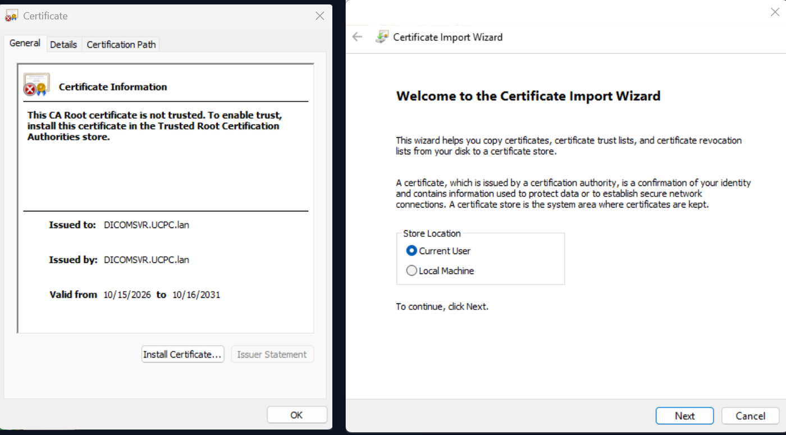
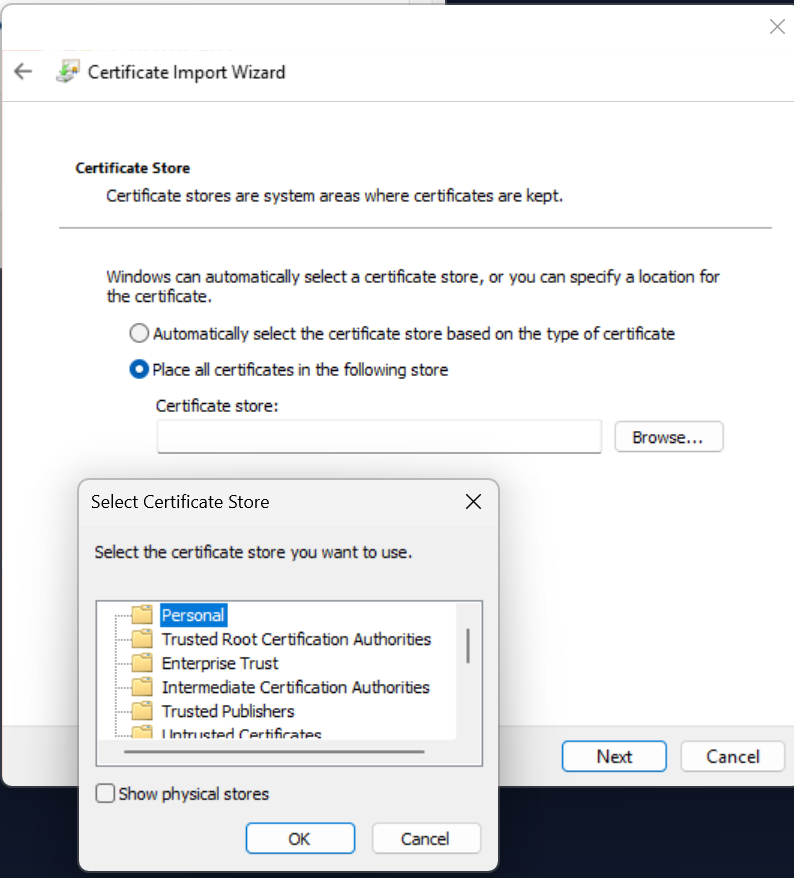
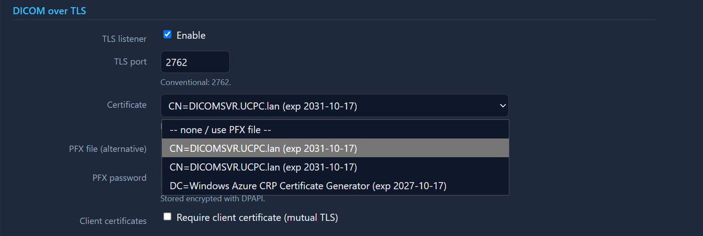

# Stopping certificate warnings

Trust the server's certificate on client PCs, or install one from your own CA.

### 1. Run the trust script (easiest)

1.  On the login page or Help page download Trust-TekVaultPACS.cmd and double-click it.
2.  It asks for administrator rights, installs the server certificate under Trusted Root Certification Authorities for the whole PC, removes any stale copies with the same name and offers to restart the browser.
3.  Done. The next two steps are the manual alternative.

In the console: `/trust-server.cmd`

### 2. Install it on a PC

1.  Double-click server.cer, then Install Certificate….
2.  In the wizard choose Local Machine (so every user of the PC trusts it; Current User works for just yourself) and press Next.

### 3. Pick the Trusted Root store

1.  Choose 'Place all certificates in the following store', then Browse…, then Trusted Root Certification Authorities, then OK, then Next, then Finish, and confirm the security warning.
2.  Restart the browser. The warning is gone.

### 4. Or push it by Group Policy

Computer Configuration, then Policies, then Windows Settings, then Security Settings, then Public Key Policies, then Trusted Root Certification Authorities, then Import.

### 5. Or use a CA-issued certificate

1.  Import a certificate for the server's DNS name into the Local Machine Personal store, then select it on the DICOM & TLS page under Settings (it is used for HTTPS too).
2.  The service account is granted access to its private key automatically when you save.

In the console: `/settings/dicom`

DICOM & TLS settings, certificate dropdown

[Signing in and permissions](signin.md) · [All guides](index.md) · [Storage locations and quotas](storage.md)
