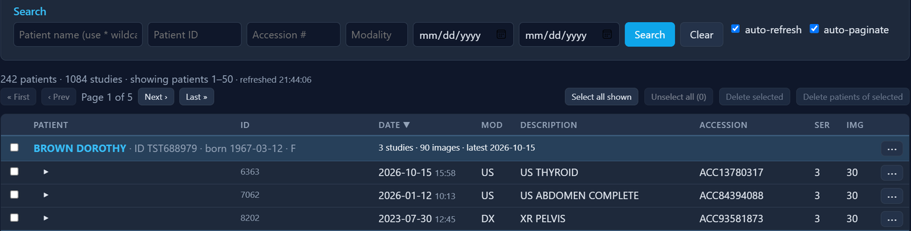
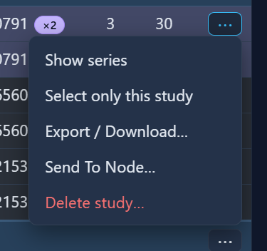
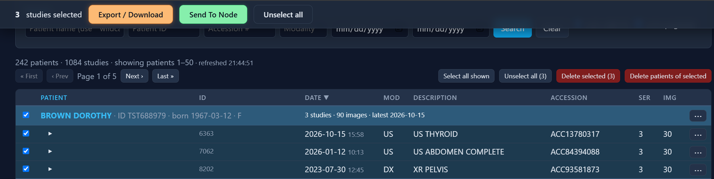
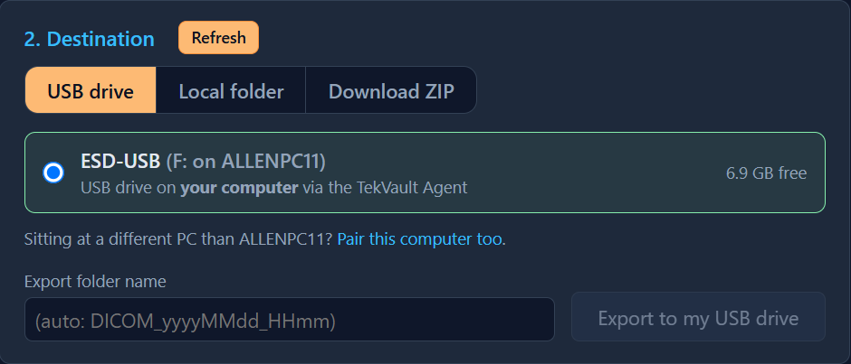
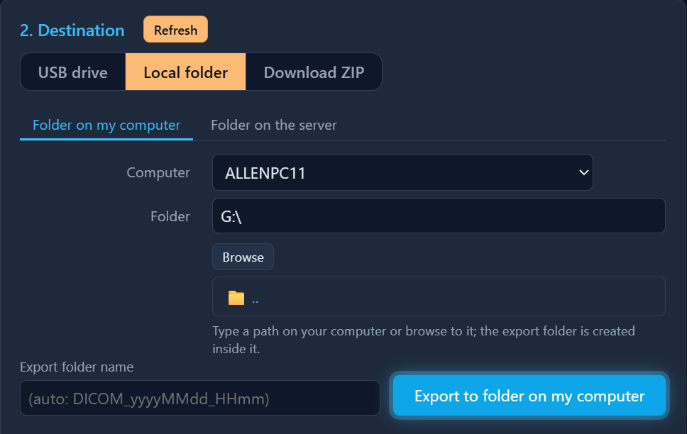
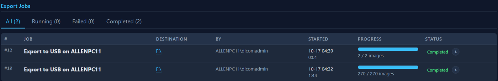
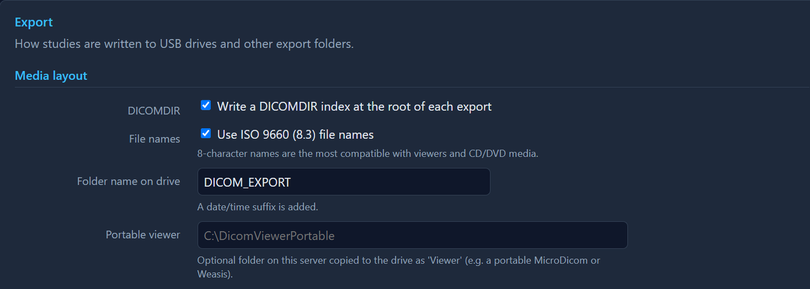

# Finding and exporting studies

Search the archive, select studies and download a ZIP or write them to a USB drive.

### 1. Find the studies

1.  Open Studies.
2.  Filter by patient name (use \* as a wildcard), ID, accession, modality or date range and press Search; 'More fields' adds study ID, sex, birth date, referring physician, institution, station, source, status and importer, and 'all columns' shows them in the table.
3.  Click a patient row to expand its studies.
4.  The ▸ arrow shows the series.

In the console: `/studies`

### 2. Per-study actions

1.  The ⋯ button at the end of every row opens a menu: show the series, select only this study, jump straight to Export / Download or Send To Node with it selected, or (administrators) delete it.
2.  Patient rows have the same menu for all of a patient's studies.

In the console: `/studies`

### 3. Select what to export

1.  Tick the studies you need, or the checkbox on a patient row to take all of them.
2.  A bar appears at the top with Export / Download and Send To Node buttons and the number of selected studies.

In the console: `/studies`

### 4. Choose the destination

1.  Press Export / Download.
2.  Pick 'Download to this computer' for a ZIP you save from the browser, a USB drive plugged into the server, or (with the TekVault Agent installed) a USB drive on your own PC.
3.  Optionally set a folder name.

In the console: `/export`

### 5. Or export to a folder

1.  Choose Local folder.
2.  'Folder on my computer' lets you type or browse to any folder on your PC (via the TekVault Agent); 'Folder on the server' offers the folders your administrator configured.
3.  The export folder (auto-named or the name you enter) is created inside it.

In the console: `/export`

### 6. Start and follow the job

1.  Press the Export button.
2.  The Export Jobs table shows progress.
3.  A ZIP shows a 'Ready to download' button when finished.
4.  Click the ⓘ badge for details and any errors.

In the console: `/export`

### 7. Use the result

1.  The export contains DICOM files, a DICOMDIR and the built-in viewer (see below), readable by any DICOM viewer or any web browser.
2.  Server USB drives should be ejected safely from Windows before unplugging.
3.  Downloads are kept on the server for 12 hours.
4.  Administrators choose the media layout on the Export page under Settings: DICOMDIR on/off, 8.3 file names for maximum compatibility, the default folder name, and an optional portable viewer copied onto the drive.

In the console: `/settings/export`

### 8. Write a CD or DVD

1.  On the Export page choose **CD / DVD**.
2.  TekVault PACS asks the TekVault Agent on your PC which optical drives it has and what disc is in each one.
3.  Blank CD-R, DVD±R, dual layer or Blu-ray, or a disc with data already on it (a new session is added).
4.  Drives without a usable disc are greyed out with the reason.
5.  Give the disc a label if you like and press **Write CD / DVD**.

<!-- -->

1.  The export is built on the server, streamed to your PC and written by the drive there.
2.  The job on the Export page follows the burn and the agent shows a notification when the disc is finished.
3.  By default the disc is ejected when it is done (Settings, Export).
4.  A CD holds about 700 MB and a DVD 4.7 GB.
5.  The job stops with a clear message if the selection does not fit.

<!-- -->

1.  The TekVault Agent on the PC must be 1.6 or newer.
2.  Older agents offer an update in their tray menu.
3.  Writing is done by the Windows disc-burning service (IMAPI), which every Windows 10 / 11 has.

### 9. The built-in viewer

1.  Every disc carries `OPEN_VIEWER.html` and a `Viewer` folder.
2.  Unless switched off on the Export page under Settings, every USB, folder and ZIP export carries it too.
3.  On a Windows PC, inserting the disc shows the AutoPlay prompt "Open the image viewer".
4.  On any computer, double-click `OPEN_VIEWER.html`.
5.  It opens in the default web browser on Windows, Mac, Linux, iPad or Android with nothing to install.

<!-- -->

1.  The viewer lists patients, studies and series on the left with thumbnails.
2.  The main area shows the image.
3.  Mouse wheel or arrow keys step through a series, drag pans, wheel zooms, right-drag or the sliders adjust brightness and contrast.
4.  Buttons rotate, flip, invert, fit, show 1:1, play a cine loop and print. "DICOM file" opens the original file for a radiology viewer.
5.  The images in the viewer are rendered at the window the modality sent.
6.  The untouched DICOM files and DICOMDIR are on the disc for full fidelity.

[Viewing images in the browser](viewer.md) · [All guides](index.md) · [Sending studies to another node](send.md)
