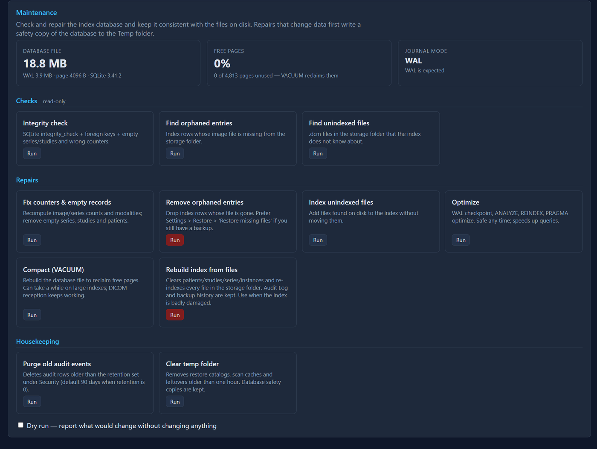
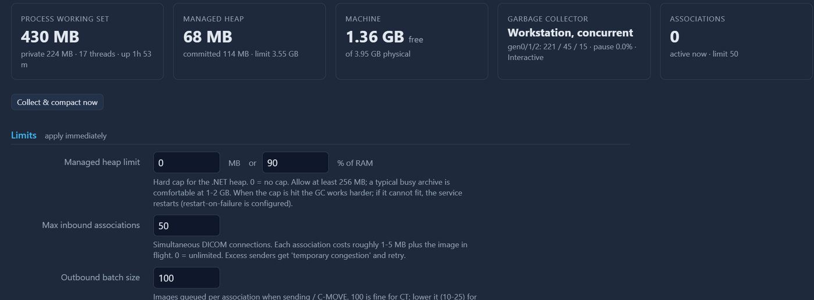
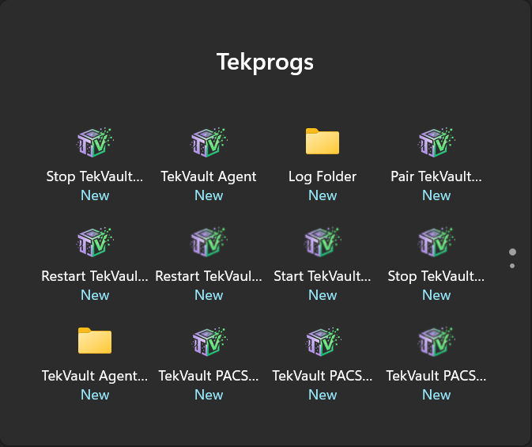

# Keeping the server healthy

Maintenance checks, logs and resource tuning.

### 1. Run the checks

1.  Under Settings, go to Maintenance, and look for Check (dry run) first.
2.  It reports orphaned entries, unindexed files and counter mismatches without changing anything.
3.  Then run the matching repair.
4.  A safety copy of the database is written first.

In the console: `/settings/maintenance`

### 2. Watch resources

1.  Under Settings, the Memory page shows the service's memory and lets you cap it.
2.  Bandwidth & Sending limits transfer rates and concurrency.
3.  Storage shows disk use.
4.  The service restarts itself automatically on failure.

In the console: `/settings/memory`

### 3. Find the logs

1.  Log files are in the data folder's Logs subfolder (path shown on the Help page and in Start Menu, then Tekprogs, then 'PACS - Log folder').
2.  Warnings and errors also go to the Windows Event Log (source DicomServer).
3.  The Start Menu 'PACS - Service status' shortcut checks ports and firewall rules.

### 4. Monitor from outside

1.  GET /health returns JSON with version, listener state and storage.
2.  Point your monitoring at it (no sign-in needed).

In the console: `/health`

[Working with jobs](jobs.md) · [All guides](index.md)
