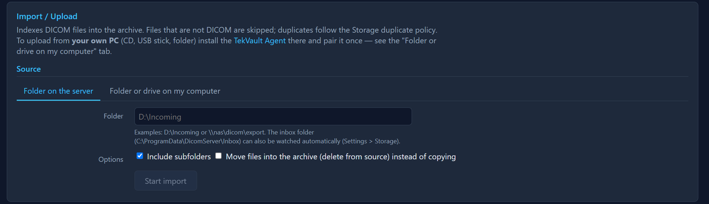
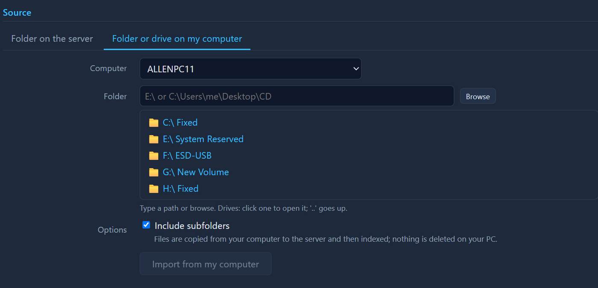
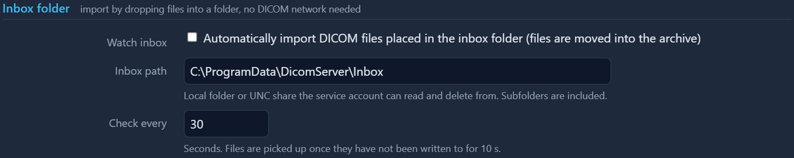
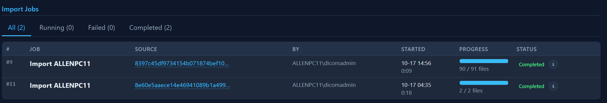

# Importing files without the network

Bring DICOM files in from a folder on the server, from your own PC via the agent, or through the inbox folder.

### 1. From a folder on the server

1.  Open Import / Upload, then 'Folder on the server'.
2.  Enter the path (local or UNC the service account can read), choose whether to include subfolders and whether to move or copy, then Start import.

In the console: `/import`

### 2. From your own PC (CD, USB stick, folder)

1.  Install the TekVault Agent on your PC (link on the Import and Export pages) and pair it once with a code from the Export page.
2.  Then use the 'Folder or drive on my computer' tab, browse to the folder and press Import from my computer.

In the console: `/import`

### 3. Automatic inbox

1.  Administrators can enable the Inbox on the Storage page under Settings.
2.  Any DICOM file dropped into that folder is imported automatically.
3.  Under *After a file has been handled* choose what happens to it: **Move it to folders** sorts every file into `_imported` (now in the archive), `_skipped` (already in the archive, or not a DICOM file) or `_failed` beside the inbox, keeping the export's own folder structure, so a glance at the inbox shows exactly what became of each file; **Delete** removes files once they are safely stored; **Leave in place** keeps them untouched and remembers them so nothing is imported twice.
4.  The three result folders are never scanned again.

In the console: `/settings/storage`

### 4. Check the result

1.  Import Jobs shows images imported, skipped (not DICOM or duplicates) and failed.
2.  Duplicates follow the policy on the Storage page under Settings.

In the console: `/jobs`

[Sending studies to another node](send.md) · [All guides](index.md) · [Installing and pairing the TekVault Agent](agent.md)
