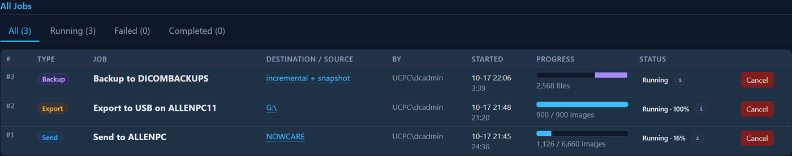
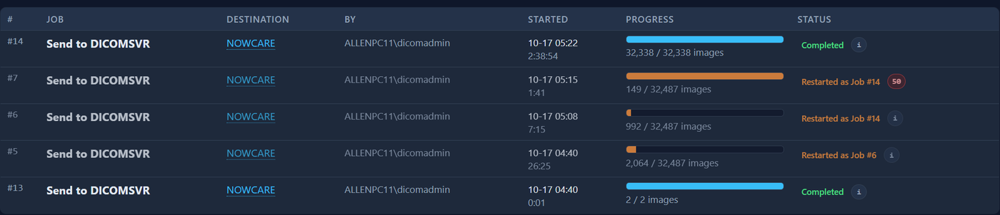
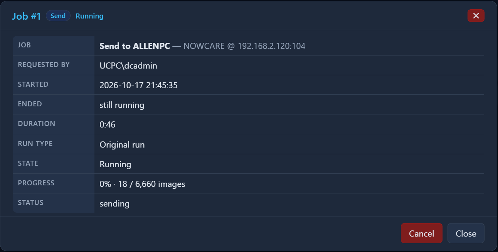
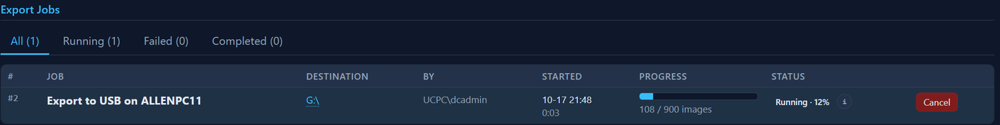
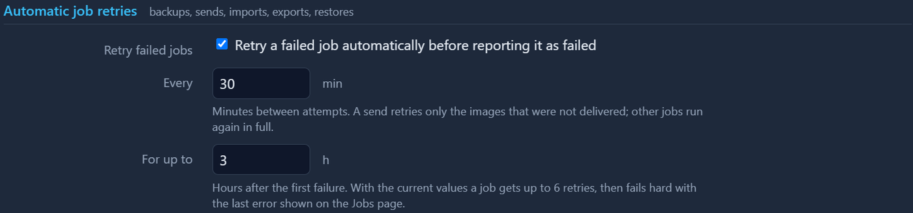

# Working with jobs

Understand the Jobs table, retries and the details popup.

### 1. Open the Jobs page

1.  Jobs lists every background task: backups, sends, imports, exports and restores.
2.  Each has a number, destination/source, who started it, progress and status.
3.  The Send, Export and Import pages show the same table filtered to their kind.

In the console: `/jobs`

### 2. Read a status

1.  Completed is green, Failed red, Cancelled grey, Retrying orange with a countdown, and Restarted (orange) when a Retry created a new job.
2.  The new job number is shown.

### 3. See the details

Click the ⓘ badge (it turns red with a count when there are errors) or the destination link to open the job popup: full status, timing, attempt count and every error in a table.

In the console: `/jobs`

### 4. Cancel or retry

1.  Running jobs have Cancel.
2.  Failed ones have Retry.
3.  Pressing Retry while a retry is already running shows a notice instead of starting a duplicate.

### 5. Adjust automatic retries

1.  Under Settings, go to Bandwidth & Sending, and look for 'Automatic job retries' sets how often a failed job is retried and for how long before it is reported as failed.
2.  The hint shows how many retries that gives.

In the console: `/settings/bandwidth`

[Backups and restore](backup.md) · [All guides](index.md) · [Keeping the server healthy](health.md)
