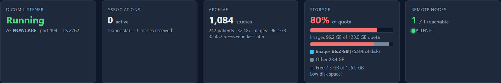
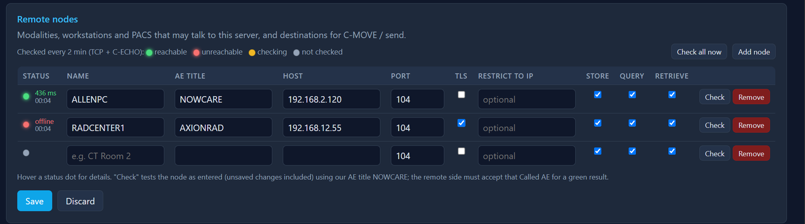
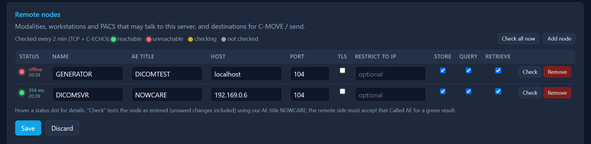
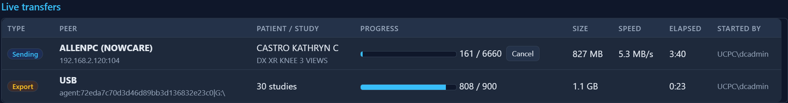
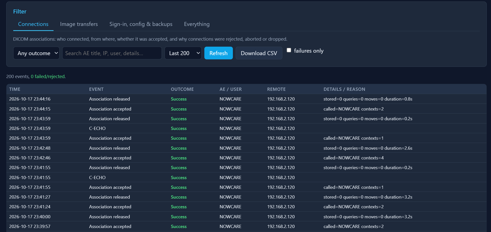
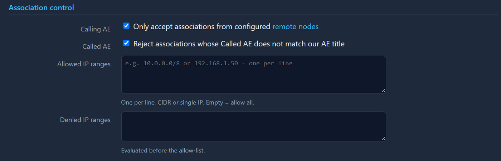

# Receiving images from a modality or PACS

Register the sender, point it at this server and verify the first transfer.

### 1. Note the server's AE title and port

1.  Open the Dashboard.
2.  The first card shows the AE title and the DICOM port (and TLS port if enabled).
3.  Modalities must use this exact AE title as the Called AE.

In the console: `/`

### 2. Add the sender as a remote node

1.  Under Settings, go to Remote nodes and press Add.
2.  Enter a friendly name, the device's AE title, its IP or host name and its DICOM port.
3.  Save.

In the console: `/settings/nodes`

### 3. Configure the modality

1.  On the modality or sending PACS, add a destination with this server's AE title, IP address and port.
2.  Run a C-ECHO (verification) from the device. It should succeed.

Example: another TekVault PACS's Remote nodes page pointing at this server (its AE title, IP address and port). Vendor consoles ask for the same three values.

### 4. Send a test study

1.  Send one study.
2.  On the Dashboard, Live transfers shows the association and image count while it runs.
3.  It then appears under Recent transfers as Transfer complete.

In the console: `/`

### 5. If it is rejected

1.  Open Audit Log, then Connections.
2.  Every rejected association lists the reason: unknown AE title, wrong called AE, or the sender not in the node list.
3.  Fix the node entry and try again.

In the console: `/audit`

Audit Log: Connections tab (tick 'failures only' to see rejections)

### 6. Optional: accept any sender

1.  Under Settings, go to Security. Association control decides who may connect: untick 'Only accept associations from configured remote nodes' to accept any AE title, and use the allowed / denied IP ranges to limit it to your network.
2.  'Reject associations whose Called AE does not match' keeps misconfigured senders out.

In the console: `/settings/security`

[Installing and pairing the TekVault Agent](agent.md) · [All guides](index.md) · [Automatic routing (forwarding) of studies](routing.md)
