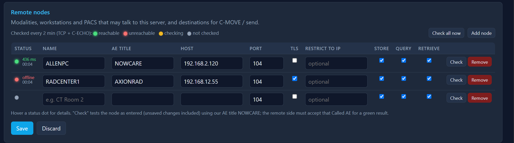
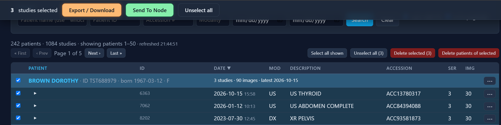
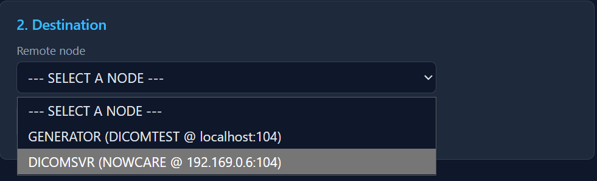
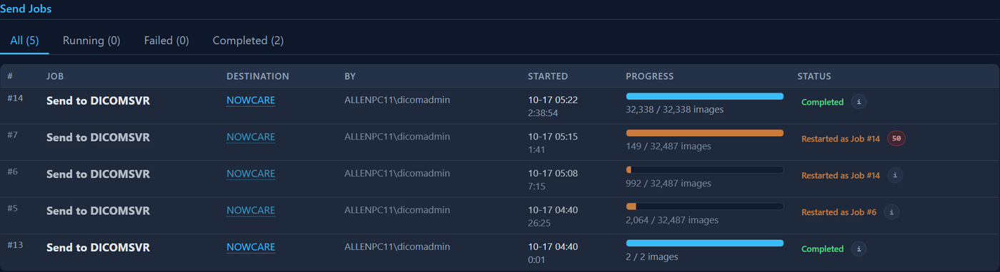
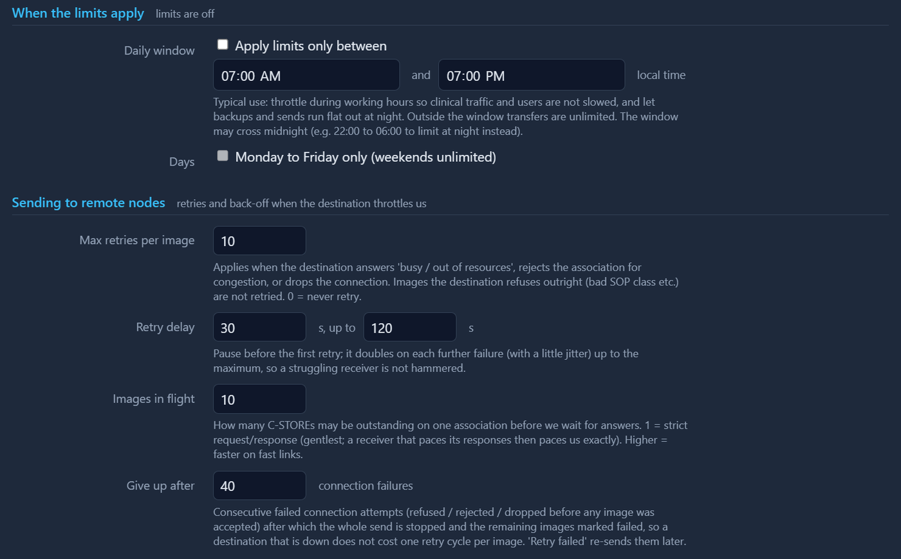

# Sending studies to another node

Forward selected studies to a remote PACS or workstation with C-STORE.

### 1. Make sure the destination exists

1.  Destinations are the remote nodes on the Remote nodes page under Settings (administrators).
2.  Use 'Check' on a node to confirm it answers C-ECHO.
3.  The node's Queue button sets how sends to it are released: studies at the same time, hold the queue, a daily send window, keep pending while unreachable.

In the console: `/settings/nodes`

### 2. Select studies

In Studies, tick the studies to send, then press Send To Node in the selection bar.

In the console: `/studies`

### 3. Pick the node and send

1.  Choose the destination from the list and press Send.
2.  One job is created per study and queued for that node.
3.  Jobs start according to the node's queue rules (how many studies at once, a send window, hold, keep-pending-while-unreachable).
4.  You can leave the page.

In the console: `/send`

### 4. Watch the job

1.  Send Jobs lists one row per study: Queued (with the reason it is waiting.
2.  Press Send now in the job popup to override), then images delivered, failed and retried.
3.  Busy receivers are handled with back-off.
4.  A failed job retries automatically for a while and Retry re-sends only the undelivered images.

In the console: `/jobs`

### 5. Tune how sends behave

1.  Under Settings, go to Bandwidth & Sending, and look for 'Sending to remote nodes' sets the per-image retries, the back-off delay, how many images are in flight on one association (1 is gentlest for a receiver that throttles) and when to give up on a destination that is down.
2.  Under Settings, go to Memory. Connections caps how many outgoing associations run at once.

In the console: `/settings/bandwidth`

Bandwidth & sending: daily limit window and send retry settings

[Finding and exporting studies](export.md) · [All guides](index.md) · [Importing files without the network](import.md)
