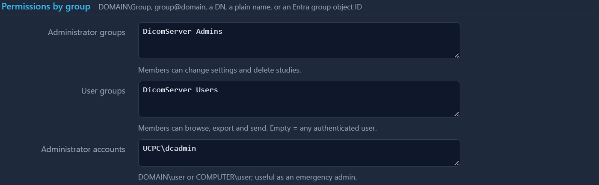
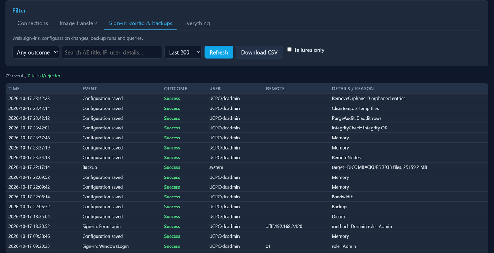

# Signing in and permissions

Choose how users sign in and who gets administrator rights.

### 1. First sign-in after install

1.  The account that ran the installer is listed under 'Administrator accounts' automatically, so it can sign in as administrator even if it is in none of the groups yet.
2.  In Local mode the installer can also create a dedicated local admin user.
3.  Sign in with one of those, then set the groups in the next steps.
4.  If nobody can sign in, run `DicomServer.Setup add-admin` on the server. See the [Emergency administrator](emergency.md) guide.

### 2. Pick the sign-in mode

1.  Open Settings, Web & Login.
2.  On a domain-joined server choose Windows domain accounts, otherwise local Windows accounts.
3.  Microsoft 365 (Entra ID) sign-in can be added alongside either.

In the console: `/settings/web`

Web & login settings, sign-in section

### 3. Assign groups

1.  Enter the administrator group(s) and user group(s).
2.  Administrators change settings and delete studies.
3.  Users browse, export and send.
4.  Leave the user groups empty to allow any authenticated account.

### 4. Emergency administrators

1.  The 'Administrator accounts' list names individual accounts that are always administrators.
2.  Useful before the groups exist. The installing account is added automatically.

### 5. Test a sign-in

1.  Sign out and sign back in as a test user.
2.  The sidebar footer shows the role that was resolved.
3.  The Audit Log, then Sign-in tab records every attempt with the reason for failures.
4.  From the server, 'DicomServer.Setup test-login' does the same from the command line.

In the console: `/audit`

### 6. Sign in with Microsoft (Entra ID) in one step

1.  Under Settings, go to Web & Login, and look for *O365 / Azure AD Settings*, then **Set up Sign in with Microsoft**.
2.  The page shows a short code.
3.  Open microsoft.com/devicelogin on any device, enter the code and sign in with a **Global Administrator** account of the tenant.
4.  TekVault PACS then registers itself in Microsoft Entra: an app registration named "TekVault PACS" with this console's address as redirect URI, Admin and User app roles, the groups claim, admin consent for the sign-in permissions and a two-year client secret.
5.  The administrator who signed in gets the Admin role straight away, and the tenant ID, client ID and secret are filled into the form.

<!-- -->

1.  Press Save and restart the TekVault PACS service.
2.  A "Sign in with Microsoft" button appears on the login page.
3.  Give other staff access in the Microsoft Entra admin center under Enterprise applications, then TekVault PACS, then Users and groups (role Admin or User), or list Entra group object IDs in the permission lists.
4.  The console must be opened over HTTPS for the setup, because Microsoft only accepts https redirect URIs.
5.  The registration can still be made by hand in the Entra portal and typed in below the wizard.

[Automatic routing (forwarding) of studies](routing.md) · [All guides](index.md) · [Stopping certificate warnings](certificate.md)
