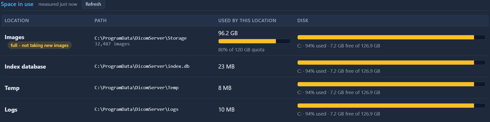
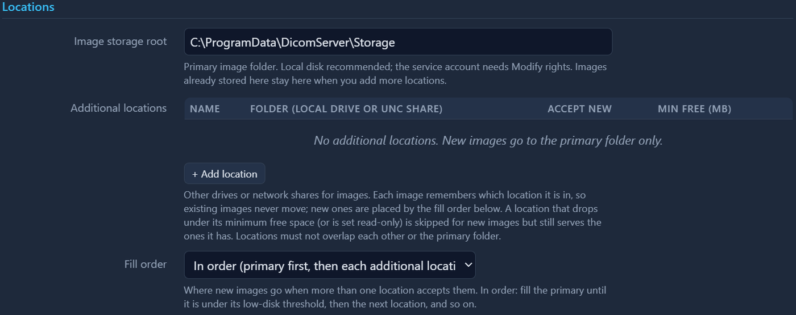
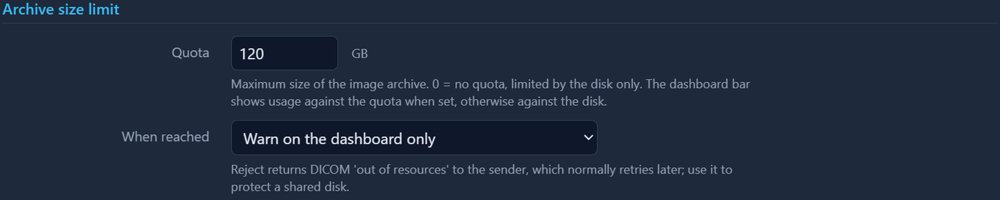
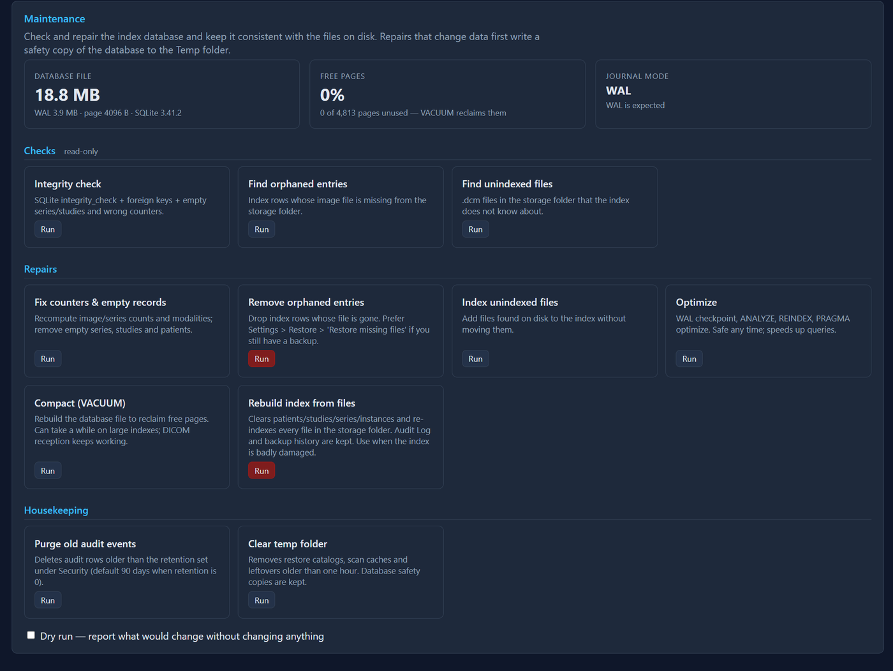

# Storage locations and quotas

Add drives, control where new images go, and set limits.

### 1. See what is used

1.  Under Settings, go to Storage. Space in use lists every location with images, used space and free space.
2.  The Dashboard storage card shows the same with one row per location.

In the console: `/settings/storage`

### 2. Add a location

1.  Under Additional locations press Add location, give it a name and a folder (another drive or a UNC share), and save.
2.  Existing images stay where they are.
3.  New ones are placed by the Fill order (in order, most free space, or round robin).

### 3. Protect the disks

1.  Each location has a minimum free space.
2.  The primary uses the low-disk threshold.
3.  A location below its minimum, or set read-only, keeps serving its images but takes nothing new.
4.  An archive quota (GB) can warn or reject new images.

### 4. Keep it consistent

1.  Under Settings, the Maintenance page checks every location for orphaned index entries and unindexed files and can repair them; 'Rebuild index' re-indexes all locations.

In the console: `/settings/maintenance`

### 5. Choose the folder layout

1.  Under Settings, go to Storage, and look for Locations, then **Folder layout** decides how image files are arranged under each location.
2.  The default, *hashed*, puts every study under one of 256 short folders (`Storage\a7\{StudyUID}\{SeriesUID}\image.dcm`).
3.  Compact and fast however large the archive grows.
4.  *By patient name* stores `Storage\LASTNAME, FIRSTNAME (12345)\20261111_{StudyUID}\{SeriesUID}\image.dcm`, so staff can find a patient's images by browsing the storage share in Explorer.
5.  Two more named layouts: *By last name, then first name* (`Storage\LASTNAME\FIRSTNAME (12345)\20261111_{StudyUID}\…`) and *By date, then patient name* (`Storage\2026\2026-11-11\LASTNAME, FIRSTNAME (12345)\{StudyUID}\…`).

<!-- -->

1.  The setting applies to images received or imported from then on.
2.  Every image remembers its own path, so existing files stay where they are and both layouts can coexist.
3.  To move the whole archive into the chosen layout run Settings, Maintenance, then **Reorganise files** (tick dry run first to see how many files would move).
4.  Backups store files under the same paths and restores find a study in either layout.
5.  When a patient's name or ID is corrected (Studies, then Edit patient details), files in the by-patient layout move to the renamed folder.

[Stopping certificate warnings](certificate.md) · [All guides](index.md) · [Backups and restore](backup.md)
